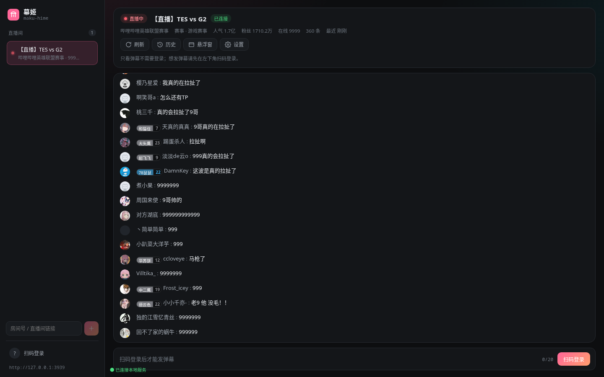
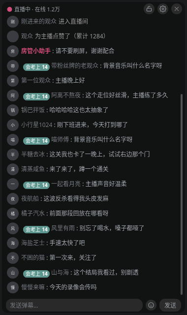
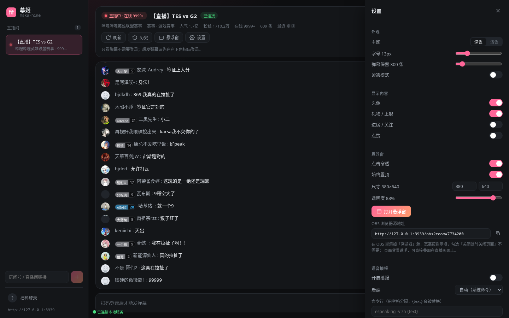

# maku-hime · 幕姬

> 轻量、可穿屏的 B 站弹幕姬。原生直连 B 站直播协议，零外部服务；一份引擎同时喂饱桌面面板、悬浮窗和 OBS 浏览器源。



| 悬浮窗（可穿屏） | OBS 弹幕墙 |
| --- | --- |
|  |  |

| 设置抽屉 | |
| --- | --- |
|  | 深浅两套主题、字号/行数/透明度/点击穿透/语音播报都在这里调 |

## 特性

- **原生直连**：自己实现 B 站直播的 WebSocket 协议（16 字节帧头、zlib/brotli 嵌套解压、
  WBI 签名的 getDanmuInfo、心跳与看门狗），不依赖 UniBarrage / blivedm 之类的中间服务，
  填房间号就能收弹幕。
- **完整消息类型**：聊天、礼物（新的 protobuf `SEND_GIFT_V2`）、上舰、醒目留言、进房/关注/
  点赞、人气与在线人数、开播下播。粉丝勋章带渐变配色，长弹幕自动换行。
- **三种展示面**：桌面控制面板、无边框穿透悬浮窗、OBS 浏览器源，全部连同一个本地服务，
  看到的内容完全一致。
- **悬浮窗**：透明、置顶、无边框，支持点击穿透（锁定时不挡鼠标）、拖拽移动、右下角缩放，
  位置尺寸写进配置，下次启动恢复。
- **单实例 + 窗口记忆**：重复启动只聚焦已有窗口（带 `--overlay` 会顺带打开悬浮窗）；
  悬浮窗拖动/缩放后的位置尺寸会写回配置，下次启动恢复。
- **扫码发弹幕**：手机扫二维码登录，SESSDATA / bili_jct 只落在本机（0600 文件）；
  没登录也能只看不发，输入条会明确提示。
- **房间状态**：标题、分区、主播、粉丝数、人气值，以及官方高能榜的**真实在线人数**
  （不是把热度当在线数），30 秒刷新一次。
- **语音播报**：弹幕 / 礼物 / 上舰 / 醒目留言可分别开关，后端可选系统命令
  （edge-playback、ekho、espeak-ng、spd-say 自动探测）、自定义 argv 或浏览器语音；
  队列有上限，弹幕洪水时丢新不堆积。
- **历史与导出**：内存环形缓冲 + 按房间的 JSONL 落盘，支持按类型/关键字筛选，
  一键导出 CSV / JSON / JSONL。
- **轻**：Rust 引擎 + Tauri 壳（不是 Electron），只跑服务时几乎不占资源；
  服务端可以单独跑，当本地弹幕 API 用。

## 快速开始

### 依赖

- Rust 1.88+（本项目在 1.99 上开发；用了 edition 2024 的 let-chains）
- Node.js 20+ 与 npm
- Linux 桌面端还需要 WebKitGTK：Arch 上是 `webkit2gtk-4.1`、`gtk3`、`libayatana-appindicator`（托盘可选）

```bash
# Arch
sudo pacman -S webkit2gtk-4.1 gtk3 nodejs npm
```

### 从源码运行

```bash
npm install
npm run build            # 构建前端到 dist/
cargo run -p maku-hime   # 桌面应用（主窗口 + 悬浮窗）
```

只想跑服务（浏览器面板 / OBS）：

```bash
cargo run -p makuhime-server -- --room 7734200 --open
# 控制面板 http://127.0.0.1:3939/
# OBS 弹幕墙 http://127.0.0.1:3939/obs?room=7734200
```

### 打包

```bash
npm run tauri:build                    # 产出 deb / AppImage 到 target/release/bundle
npx tauri build --no-bundle            # 只编译 release 二进制（前端已内嵌）
npm run package                        # 打「解压即用」的 tar.gz（桌面端 + 本地服务 + dist）
```

本地实测两种 Linux 产物都能直接构建：

| 产物 | 大小 | 内容 |
|------|------|------|
| `target/release/bundle/deb/maku-hime_0.1.0_amd64.deb` | 5.2 MB | `/usr/bin/maku-hime`、`/usr/lib/maku-hime/dist`（OBS/面板静态资源）、desktop 文件、32/128/256 图标 |
| `target/release/bundle/appimage/maku-hime_0.1.0_amd64.AppImage` | 104 MB | 自带 WebKitGTK 依赖，`chmod +x` 直接运行 |
| `dist-packages/maku-hime-0.1.0-linux-x86_64.tar.gz` | 8.2 MB | 桌面端 + `maku-hime-server` + `dist/`，解压即用 |

AppImage 首次构建会下载 linuxdeploy / appimagetool（缓存在 `~/.cache/tauri`）。

Arch 这类没有 dpkg 的发行版直接装 deb 不方便，用 `npm run package` 解压即用的包即可。

## 使用

### 订阅房间

左下角输入房间号（短号也行，或直接粘贴 `https://live.bilibili.com/xxx`）回车即可订阅；
订阅列表写进配置，下次启动自动重连。支持多房间同时收，切换房间看各自的弹幕墙。

### 悬浮窗

- 面板右上角「悬浮窗」或托盘菜单打开；
- 启动时想直接开悬浮窗：`cargo run -p maku-hime -- --overlay`（或 `MAKUHIME_OPEN_OVERLAY=1`）；
- 解锁后可以拖动移动、右下角拖拽缩放，**位置与尺寸会写回 `config.toml` 并在下次启动时恢复**
  （拖动时做 400ms 防抖，不会频繁写盘）；
- 应用是**单实例**的：重复启动只会聚焦已运行的窗口；`maku-hime --overlay` 会顺带把悬浮窗打开；
- 锁定 = 点击穿透，鼠标会直接穿过悬浮窗点到下面的窗口。锁定状态下悬浮窗自己的按钮点不到，
  解锁入口在**主窗口的「悬浮窗」按钮**或**托盘菜单**里；
- Wayland 下穿透由合成器决定（niri / Hyprland 较新版本支持），不生效时它就是普通置顶窗。

  平铺式合成器会把新窗口塞进布局里，niri 用户加一条窗口规则让它浮动：

  ```kdl
  // ~/.config/niri/config.kdl
  window-rule {
      match app-id=r#"maku-hime"# title=r#"maku-hime · 弹幕墙"#
      open-floating true
  }
  ```

### OBS 浏览器源

在 OBS 里添加「浏览器」源，URL 填：

```
http://127.0.0.1:3939/obs?room=7734200
```

页面背景全透明、带文字描边，可以直接叠在画面上。想在浏览器里预览时加 `&bg=dark` 给个底板。

### 发弹幕

左下角「扫码登录」→ 用 B 站手机端扫码 → 输入条可用。发送走官方 `msg/send`，
错误会翻译成人话（未登录 / 被禁言 / 发送太频繁 / 内容重复 / 风控…）。

### 语音播报

设置 → 语音播报：打开开关、选后端、试听。

- `自动`：依次探测 edge-playback → ekho → espeak-ng → spd-say；
- `自定义命令`：填 argv，`{text}` 会替换成播报内容，例如
  `edge-tts --voice zh-CN-XiaoxiaoNeural --text {text} --write-media /tmp/t.mp3 && mpv /tmp/t.mp3`
  这种管线请用 `sh -c`；
- `浏览器语音`：用 WebView 的 speechSynthesis（无依赖，音色看系统）。

### 配置与数据

| 路径 | 内容 |
|------|------|
| `~/.config/maku-hime/config.toml` | 全部设置（外观、悬浮窗、TTS、发送、自动订阅房间） |
| `~/.config/maku-hime/credentials.json` | 扫码登录凭据（0600） |
| `~/.local/share/maku-hime/history/{room}.jsonl` | 弹幕历史，一行一个事件 |

配置示例：

```toml
[server]
port = 3939

[ui]
theme = "dark"
font_size = 13
max_rows = 300
show_avatar = true
show_gift = true

[overlay]
width = 380
height = 640
opacity = 0.88
click_through = true
always_on_top = true

[tts]
enabled = false
provider = "auto"

[danmaku]
heartbeat_seconds = 30
stats_interval_seconds = 30

rooms = [7734200]
```

## 本地接口

服务默认监听 `127.0.0.1:3939`（端口被占用会自动顺延），所有前端共用：

| 方法 | 路径 | 说明 |
|------|------|------|
| GET | `/api/health` | 健康检查 |
| GET | `/api/state` | 全量快照（房间、登录态、配置） |
| WS | `/api/ws` | 事件流（`event` / `snapshot` / `speak` / `notice`） |
| POST | `/api/rooms` | 订阅房间 `{room_id}` |
| DELETE | `/api/rooms/{id}` | 取消订阅 |
| POST | `/api/rooms/{id}/refresh` | 刷新房间信息 |
| POST | `/api/send` | 发弹幕 `{room_id, text}` |
| GET | `/api/history/{id}?kinds=chat,gift&q=&limit=` | 历史查询 |
| GET | `/api/history/{id}/export?format=csv` | 导出 |
| GET | `/api/login/qrcode` / `/api/login/qrcode/poll?key=` | 扫码登录 |
| POST | `/api/login/logout` | 退出登录 |
| GET/PUT | `/api/config` | 读写配置 |
| POST | `/api/tts/test` | 试听 `{text}` |

## 项目结构

```
crates/makuhime-core/    协议、解析、引擎、历史、TTS、登录、发送
crates/makuhime-server/  axum REST + WebSocket + 静态页面
src-tauri/               Tauri 桌面壳（主窗口、悬浮窗、托盘、窗口指令）
src/                     React 前端（控制面板 + 弹幕墙）
scripts/                 录制真实弹幕、截图、图标生成、开发启动
docs/                    设计说明、协议调研、官方面板排版规格
```

协议细节与架构取舍见 [docs/design.md](docs/design.md)，
调研原文见 [docs/research/bilibili-protocol.md](docs/research/bilibili-protocol.md) 与
[docs/research/chat-panel-parity.md](docs/research/chat-panel-parity.md)。

## 开发

```bash
bash scripts/dev.sh 7734200   # 同时起 Rust 服务（3939）与 Vite（5173，热更新）
cargo test                    # 引擎 / 解析 / 历史 / 路由测试（79 个）
npm test                      # 前端组件与状态测试（Vitest + Testing Library，17 个）
npm run lint                  # ESLint（TypeScript + react-hooks）
npm run typecheck             # 前端类型检查
node scripts/screenshot.mjs http://localhost:5173/ shot.png 8000 1440 900   # headless 截图
node scripts/capture.mjs 7734200 60 fixtures/live.jsonl                     # 录制真实弹幕做夹具
```

弹幕夹具 `crates/makuhime-core/tests/fixtures/messages.jsonl` 就是真实抓包裁剪出来的，
解析器的单元测试跑在它上面。前端测试覆盖数字/在线人数/时间格式化、zustand 去重与窗口裁剪，
以及弹幕墙的「只渲染最近 N 条」「上翻不打断阅读 + 新弹幕提示」等行为。
CI（`.github/workflows/ci.yml`）会跑 `cargo fmt --check`、`cargo clippy -D warnings`、
全部 Rust 测试，以及前端的 lint / typecheck / test / build。

### 安全边界

服务默认只监听 `127.0.0.1`，并且对所有请求做来源校验（见
[`crates/makuhime-server/src/origin.rs`](crates/makuhime-server/src/origin.rs)）：

- Host 必须是回环地址，挡住 DNS rebinding；
- 带 `Origin` 的请求必须是本机页面（`http://127.0.0.1:*` / `http://localhost:*`）、
  Tauri 壳（`tauri://localhost`），或与 Host 同源（局域网部署时）；
- WebSocket 同样会校验——浏览器不会为 ws 做同源限制，不校验的话任意网页都能读走你的弹幕。

登录凭据只保存在 `~/.config/maku-hime/credentials.json`（0600，写入时先落临时文件再 rename）。

## 已知限制

- Wayland 上的点击穿透取决于合成器：原生 Wayland 窗口走 GTK3，输入区域不一定被合成器采纳，
  这时悬浮窗会退化成普通置顶窗。用 `GDK_BACKEND=x11` 启动（走 XWayland）通常能拿到可用的点击穿透：
  `GDK_BACKEND=x11 cargo run -p maku-hime -- --overlay`；
- 扫码登录需要能访问 passport.bilibili.com；
- getDanmuInfo 有风控（-352），失败时会退回默认弹幕服务器，可能收不到部分私密消息；
- OBS 页面是透明底，用浏览器直接打开看不清楚，加 `&bg=dark` 预览；
- 把 `server.host` 改成 `0.0.0.0` 会把面板暴露到局域网，此时只允许「与 Host 同源」的页面访问，
  请自行确认网络环境可信。

## 参考与致谢

- [arcana-world](https://github.com/TarocchiLive/arcana-world)：功能取舍与「弹幕姬」产品形态的参考；
- [UniBarrage](https://github.com/BarryWangQwQ/UniBarrage) 与 [blivedm-go](https://github.com/xifan2333/blivedm-go)：B 站协议实现与字段映射的对照来源；
- [dmnotifier](https://github.com/xifan2333/dmnotifier)：插件化消息管线的思路；
- [bili-dm](https://github.com/Lumorian/bili-dm)：官方聊天面板 1:1 排版、在线人数接口与穿透悬浮窗的经验。

## License

MIT
